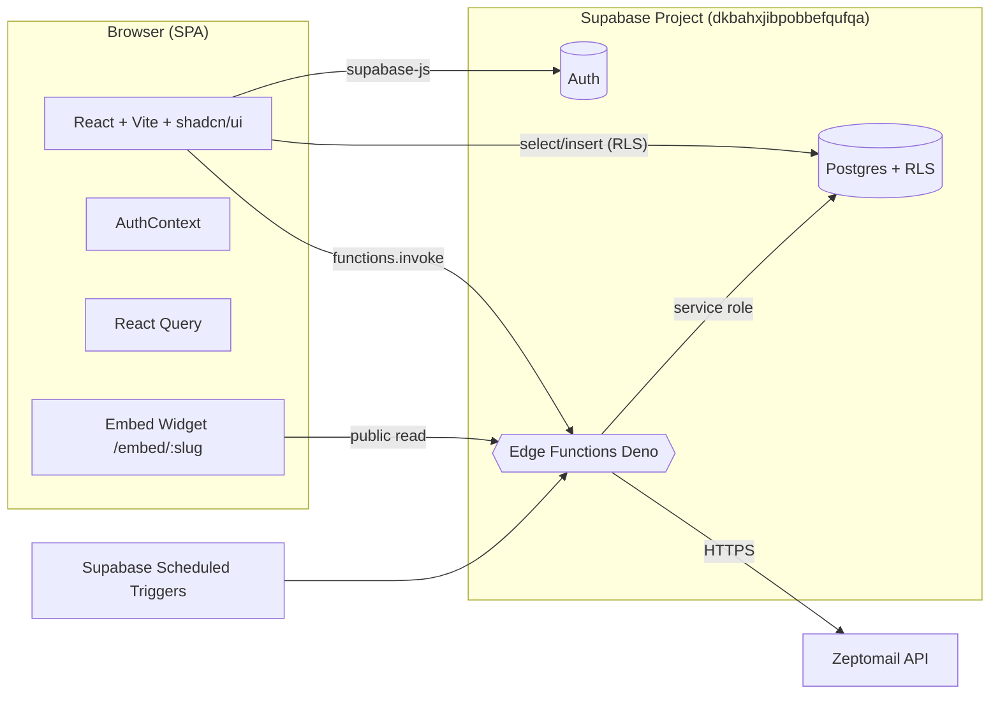
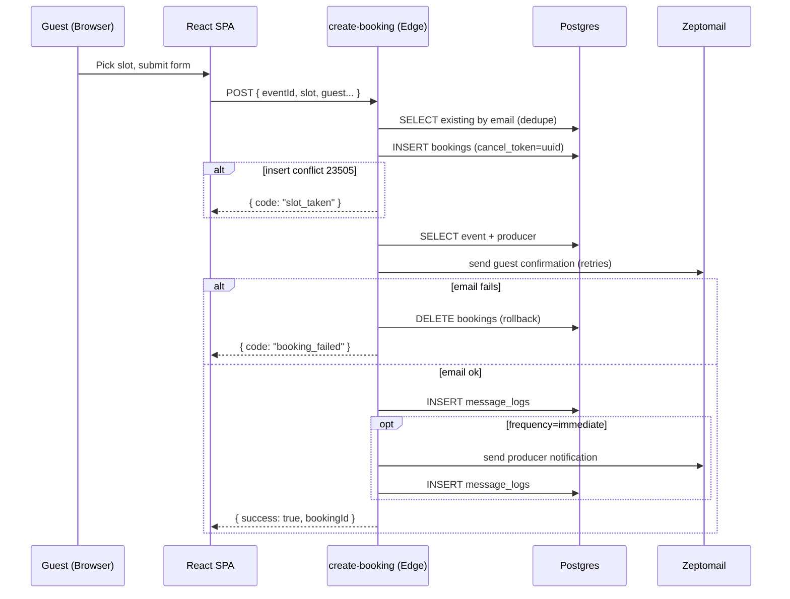
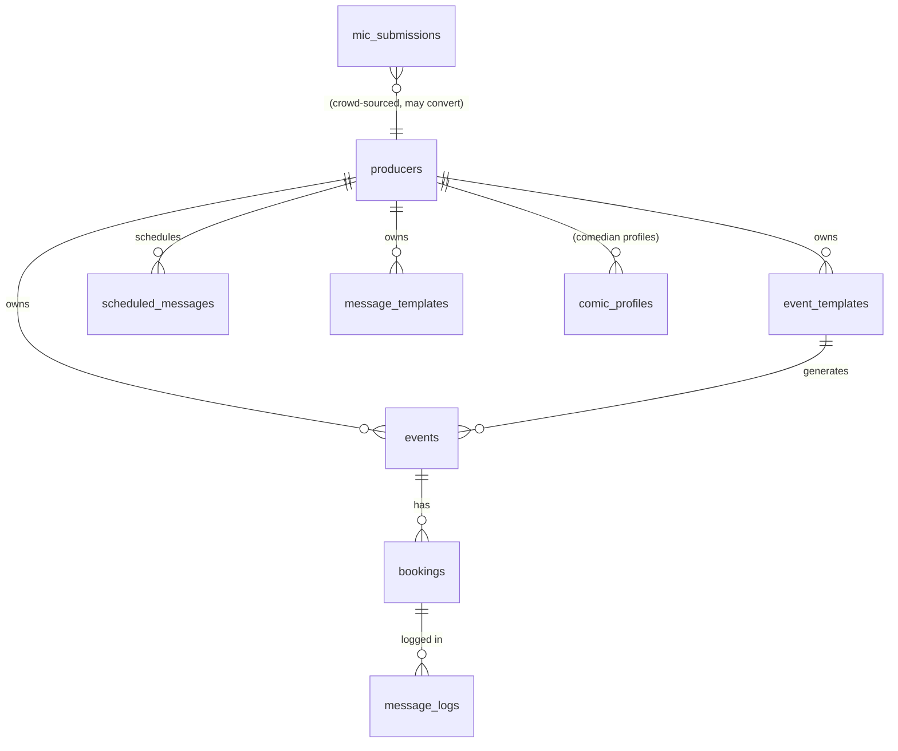

# QuackBoard Ultra-Lean — High-Level Review

## Purpose
QuackBoard is an **open mic management platform for comedy producers**. It lets producers publish events, manage lineups, take guest sign-ups for time slots, and send transactional / scheduled email notifications around bookings. Comics (guests) discover mics, sign up for spots, and manage their bookings via secure email links — without needing to authenticate.

## Primary Use Cases
- **Producer onboarding** — sign up, complete onboarding, claim a public slug (`/:slug`).
- **Event creation** — single mics, recurring mics, duplicate / edit existing mics.
- **Lineup management** — add/remove comics, export CSV, run a live lineup view (`/events/:id/lineup`).
- **Public sign-up flow** — comics pick a slot on a producer's public page (`/producer/:slug` or `/:slug`).
- **Email lifecycle** — booking confirmations, cancellations, mic-goes-live alerts, and daily/weekly/monthly digest notifications via Zeptomail.
- **Token-based self-service** — comics cancel or change alert prefs through `/cancel/:token` (no auth).
- **Embeddable widget** — `/embed/:slug` to host a calendar widget on third-party sites.
- **Mic discovery & community submission** — `/browse` and a `mic_submissions` table for crowd-sourced mics.
- **Admin** — `/admin` route exists.

## Stack
| Layer | Tech |
|---|---|
| Frontend | React 18 + Vite + TypeScript, SWC plugin |
| UI | Tailwind CSS + shadcn/ui (Radix primitives), lucide-react, sonner toasts, recharts |
| State / Data | TanStack React Query, react-hook-form + Zod |
| Routing | react-router-dom v6 (`BrowserRouter`) |
| Auth & DB | Supabase (Postgres + Auth + RLS) |
| Backend logic | Supabase Edge Functions (Deno) |
| Email | Zeptomail REST API (called from Edge Functions) |
| Scheduling | Supabase scheduled functions (daily/weekly/monthly notifications, low-signup alerts, recurring event regeneration) |
| Tooling | ESLint 9, Vitest, lovable-tagger (dev only), bun + npm lockfiles both present |

## Structure (concise)
```
src/
  pages/           ~25 route components (Dashboard, CreateMic, EventLineup, CancelBooking, EmbedWidget, Admin, ...)
  components/
    ui/            shadcn primitives + MarkdownEditor, RecurrenceSelector
    producer/      EventCard, SpotList, SignUpModal, CancelSpotModal, ...
    dashboard/     CalendarDashboard, EventDetailDialog, RecurringSeriesCard, ...
    lineup/        AddToSlotModal, RemoveFromLineupModal, ExportCsvModal
    embed/         CalendarWidget, EmbedSection
    layouts/, discover/, ProtectedRoute, Navbar, FeedbackButton
  contexts/        AuthContext (Supabase session)
  hooks/           useFormDraft, useProducerFeatures, useProducerSlug, ...
  integrations/supabase/  client.ts, types.ts (auto-generated)
  lib/             email.ts, recurring-event-generator.ts, signup-status.ts,
                   producer-notifications.ts, slug.ts, utils.ts
  types/

supabase/
  config.toml
  migrations/      ~30 SQL migrations
  functions/       12 Edge Functions:
    create-booking, send-booking-email, cancel-booking, cancel-booking-by-email,
    send-mic-goes-live-email, send-daily-/weekly-/monthly-notifications,
    send-producer-notifications, check-low-signup-alert,
    regenerate-recurring-events, get-producer-events-embed,
    auth-email-hook, _shared/
```

## Architectural Description
This is a **classic Jamstack + BaaS** app: a static React/Vite SPA talking directly to Supabase for auth + data (RLS-protected), with security-sensitive or non-trivial workflows offloaded to **Deno Edge Functions**.

Key flows:
1. **Auth** — `AuthContext` subscribes to `supabase.auth.onAuthStateChange`; `ProtectedRoute` additionally checks the user has a `producers.slug` and otherwise redirects to `/onboarding`.
2. **Booking write path** — frontend calls the `create-booking` Edge Function which: validates → checks duplicates → INSERTs booking with a `cancel_token` (UUID) → fetches event/producer → sends guest email via Zeptomail → on email failure, **rolls back by deleting the booking row** → optionally fires a "new booking" producer email if `email_frequency = 'immediate'`. Logs to `message_logs`.
3. **Email lifecycle** — `send-booking-email` is a separate function used for cancellations / manual-add flows (with retry + structured logging). Daily/weekly/monthly digest functions are run on a schedule.
4. **Cancellation** — public route `/cancel/:token` and `cancel-booking` Edge Function (`verify_jwt = false`) provide unauthenticated, token-scoped cancellation.
5. **Embed widget** — `get-producer-events-embed` Edge Function exposes producer events for third-party iframes; `/embed/:slug` renders the widget.
6. **Recurring events** — `regenerate-recurring-events` (cron) materializes occurrences from `event_templates`.

## Architectural Diagrams

### Component / Deployment View


### Booking Write Flow (sequence)


### Domain / Data Model (key tables)


## Potential Issues (preliminary)

### Security
1. **Edge Functions with `verify_jwt = false`** (`create-booking`, `cancel-booking`, `auth-email-hook`, `regenerate-recurring-events`) accept anonymous calls. There is **no rate limiting, captcha, or origin check** visible — this is a sign-up spam / enumeration / DoS surface for the Zeptomail account.
2. **Anon key + project URL hard-coded** in `src/integrations/supabase/client.ts` (intentional for Supabase, but means **all defenses must live in RLS**; any missing/loose policy is publicly exploitable).
3. **CORS is wide-open** (`Access-Control-Allow-Origin: *`) on every Edge Function — no allow-list of frontend origins.
4. **Email HTML built via string interpolation** (`guest_name`, `event.title`, `producer.name`, etc.) directly into HTML attributes. Even though it's email (limited XSS impact), broken markup / spoofed buttons / link injection are possible. The code comments say "Sanitize the parsed HTML to prevent XSS" but **no sanitizer is actually applied** to `marked.parse(producer_message)` — markdown can produce raw HTML.
5. **Cancel token = `crypto.randomUUID()`** — fine, but token never expires and is single-factor (URL alone). Anyone with the link can change alert prefs / cancel forever; consider TTL or one-time use.
6. **localStorage-based "alert preferences"** (per `DEVELOPER.md`) means trust boundary is the device, not the user — and they don't survive cross-device.
7. **`/admin` is mounted without `ProtectedRoute`** in `App.tsx` — relies entirely on inner-component auth/role check. Worth verifying the page actually gates by role, not just by `user != null`.
8. **Email rollback isn't atomic**: between INSERT booking and DELETE-on-email-fail, the slot is briefly held; concurrent attempts can hit `slot_taken` even though the original booking will be rolled back.
9. **`producer_message` is rendered as HTML in emails** — markdown is converted via `marked` with no DOMPurify-like sanitization.
10. **Service-role key in Edge Functions** is correct, but several functions also read `producer_id` from the request body and trust it (`send-booking-email` looks up the booking, but cross-checks could be tighter).
11. **Sensitive PII (guest emails, names)** stored unencrypted in `bookings` and `message_logs`; check retention/GDPR posture.

### Performance / Scalability
1. **`ProtectedRoute` runs an extra query (`producers.slug`)** on every protected navigation — not cached in React Query, so it re-fires per route change.
2. **No code splitting / lazy routes** — `App.tsx` static-imports all 25 page components, inflating initial bundle (Radix + recharts + react-markdown are all heavy).
3. **No Vite `build.rollupOptions` chunking, no `React.lazy`/`Suspense`**.
4. **Email sending is synchronous on the booking critical path** — guest waits for Zeptomail RTT + retries (up to ~4.5s of `setTimeout` backoff) before the booking is confirmed; any Zeptomail outage rolls back valid bookings.
5. **Two near-duplicate render paths** for booking confirmation HTML (in `create-booking` and `send-booking-email`) — drift risk + extra cold-start size for both functions.
6. **Email frequency lookups re-fetch the event row** in `send-booking-email` after `create-booking` already had it — extra DB roundtrip.
7. **Recurring event regeneration** (cron) and digest emails — capacity concerns scale with #producers × #events × #bookings; need indexing review on `bookings(event_id, cancelled_at)`, `events(producer_id, date)`, `message_logs(booking_id)`.
8. **Two lockfiles** (`bun.lock`, `package-lock.json`, plus `deno.lock`) — risk of dependency drift between local dev and deploy.
9. **Wildcard CORS + Edge Function cold starts** (Deno) on every booking — can be noticeable on first hit.
10. **No observable retries / DLQ** for failed digest emails beyond inline `console.error`.

### Maintainability (worth flagging)
- Two migrations with the same logical purpose (`add_email_frequency_to_events`) dated one day apart — likely conflict / re-run risk.
- README is the default Lovable template (project ID placeholder); `DEVELOPER.md` is the real source of truth.
- `prompts/` directory was just created; no existing convention.

---

## Where would you like to dive deeper?
Pick any combination of the items below for a deep-dive next:

1. **Purpose & use cases** — enumerate every page/route into a user-journey matrix (producer vs. comic vs. admin vs. anonymous), or focus on a specific persona.
2. **Stack** — dependency-risk audit (outdated/abandoned packages, license check, bundle weight per dep), or runtime/infra deep-dive (Supabase plan limits, Zeptomail quotas, Edge Function cold-start profile).
3. **Structure** — per-directory file inventory with responsibilities, or coupling/cohesion analysis (which components/pages import what).
4. **Architecture description** — expand into a formal C4 model (Context → Container → Component → Code), or a request-flow catalog covering every Edge Function.
5. **Diagrams** — full ER diagram from migrations, sequence diagrams for cancellation / digest emails / embed widget, or a state machine for an event's lifecycle (`draft → published → live → archived`).
6. **Security** — (a) audit every RLS policy across migrations, (b) trace each Edge Function for authz/CORS/rate-limit gaps, (c) check the email HTML pipeline for injection, or (d) verify the `/admin` and token flows end-to-end.
7. **Performance** — (a) bundle-size & route-splitting analysis, (b) DB index/query plan review, (c) synchronous-email critical-path latency model, or (d) load-test plan for booking + digest cron.
8. **Cross-cutting** — testing-coverage assessment (only one `.test.tsx` found), observability/logging review, or CI/deploy posture audit.

Tell me which of (1)–(8) to expand and how deep (overview, line-by-line, or actionable remediation plan).
